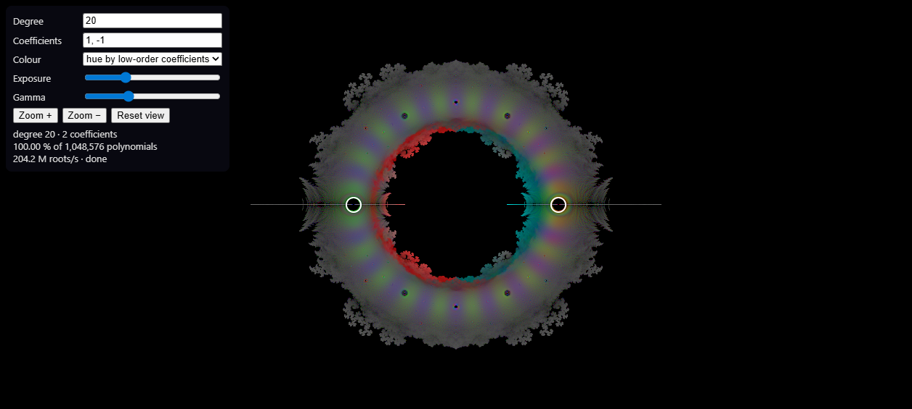

# Littlewood fractals (WebGPU)

Plots every root of every polynomial `a_0 + a_1 z + … + a_d z^d` whose coefficients `a_i` come from a set of complex numbers you choose. The default is `{1, −1}`, the Littlewood polynomials. All roots are computed on the GPU, fast enough to redraw while you drag the coefficients.



## Requirements

- **Node.js 20+** (for the dev server, build and tests).
- **A WebGPU browser** to use the app (see *Browser support*). It must be opened via `localhost` or `https://`, because WebGPU is disabled on plain `http://` from other hosts.
- **A real GPU for `npm test`:** the GPU tests run the WGSL kernels through Dawn (the `webgpu` npm package, prebuilt for Windows/macOS/Linux x64). On a machine without a usable GPU, only the 12 pure-logic test files pass.
- **Windows PowerShell:** if `npm` fails with *"running scripts is disabled on this system"*, either use `npm.cmd` (e.g. `npm.cmd run dev`) or run `Set-ExecutionPolicy -Scope CurrentUser RemoteSigned` once.

## Run

```bash
npm install
npm run dev       # http://localhost:5173  (WebGPU needs https:// or localhost)
npm test          # 178 tests: pure logic + real-GPU tests via Dawn (no browser needed)
npm run bench     # throughput + kernel-variant benchmark on this machine's GPU
npm run build     # static site in dist/
```

`scripts/pc-bench.cmd` runs tests and benchmarks on a Windows machine without Node installed. It downloads a portable Node 22 into `%LOCALAPPDATA%` (no admin rights needed). Run it from a copy of the repo **in a path without spaces**, e.g. `C:\lwf\scripts\pc-bench.cmd`.

## Controls

| Action | How |
|---|---|
| Move a coefficient | Drag its white ring. While dragging, every frame renders as many full-degree polynomials as fit in ~12 ms, spread evenly over the whole set, so the preview already looks like the final picture (the status line shows `preview · 3.1 % sampled`). On release it keeps refining the same sample to 100 % instead of starting over. |
| Set coefficients exactly | Type in **Coefficients**, e.g. `1, -1`, `1, i, -1, -i`, `0.5+0.3i, -1` (1–16 values), then press Enter. |
| Degree | 1–32 |
| Pan / zoom | Drag the background / mouse wheel (zooms around the cursor) / **Zoom ±** / **Reset view** |
| Colour | Hue by low-order coefficients (Egan's palette idea), or inferno density. Exposure and gamma apply instantly, without recomputing. |
| Kernel | **auto** (default) times both GPU kernels at startup and keeps the faster one. The choice and the measured ratio are shown in the status line. You can also force either kernel. |
| Save PNG | Type the width × height, then **Save PNG**. The image is re-rendered at that size (never upscaled), shows everything currently on screen (extra margin if the aspect differs), and matches the screen's brightness. Up to 64 M pixels (e.g. 8192×8192 or 16384×4096) within the GPU's limits. Live rendering pauses while it exports. The PNG carries the full settings (see *Reproduction metadata*). |
| Coefficient rings | **Show coefficient rings** (off by default) draws the white handle rings into Save PNG and animation frames, sized like a screenshot of the screen at the export's resolution. In animations they follow each frame's coefficients. |
| Save settings / Load | **Save settings (.json)** downloads the current state (coefficients, degree, view, display, export size, keyframes and animation settings). **Load…**, or dropping a file anywhere on the page, restores it from such a JSON, from a PNG saved by the app, or from a rendered MP4. |
| Animation keyframes | Open **Animation**. Set the coefficients, **Add keyframe**, move them, add the next one; any number of keyframes (at least 2). Each coefficient moves in a straight line from keyframe to keyframe, with equal time per segment. With **Attach view (zoom + centre)** (on by default) a keyframe also stores what is on screen, so the animation can zoom and pan; with **Attach exposure/gamma** (on by default) it stores the two sliders. The list marks them 📷 (view) and ◐ (exposure/gamma). Ghost rings and dashed lines on the picture show the keyframes and the paths. Click a keyframe to jump to it (coefficients, view, exposure/gamma), × to remove it, **Clear** to start over. Changing the number of coefficients clears the keyframes. |
| Timeline | Drag the slider to scrub: the live view shows that moment, including the view and exposure/gamma (as a sampled preview, like dragging a handle). **▶ Preview** plays the frames the render will use, at the chosen FPS, looping. |
| Animation settings | **Loop back to start** adds the first keyframe at the end and drops the duplicate last frame, so the video loops seamlessly. **Frames**, **FPS**. **Easing**: smooth (slow start and end) or linear. **Brightness**: *locked: density per area* (default; zoom-aware, see *View keyframes*), *locked to frame 0's densest pixel* (the old mode; zooming in darkens), or *per frame* (may pulse). **Quality**: 100 % for the final video; 50/25/10 % drafts render only that share of the polynomials per frame (an even sample, so the draft is noisier but otherwise the same picture). |
| Render animation | Size comes from the Save PNG W × H. **Output**: MP4 (H.264), MP4 + PNG frames, or PNG frames (`frame_00000.png`…; folder outputs need Chrome/Edge). You choose the file or folder first, then every frame is rendered at full size and written as it is finished. The status shows progress, ms/frame and the time left; **Cancel** stops it. Live rendering pauses meanwhile. |

## Browser support

WebGPU only (no WebGL fallback, by design):
- Chrome/Edge 113+ on Windows, macOS and ChromeOS
- Chrome on Android 12+
- Chrome on Linux with recent Intel or NVIDIA GPUs
- Safari 26+
- Firefox 141+ on Windows

Other browsers show an explanatory message.

## Performance

Benchmarks of record (`npm run bench`, 1024×1024 histogram, "one chunk in flight" mode as in the app):

| Case | Polynomials | RX 9060 XT (PC) | Arc 140T iGPU (laptop) |
|---|---|---|---|
| Littlewood d=20 | 1 048 576 | **67 ms** (313 M roots/s) | 110–250 ms |
| Littlewood d=24 | 16 777 216 | **0.96 s** (421 M roots/s) | 3.2–5 s |
| 3 complex coefficients, d=14 | 14 348 907 | **0.32 s** (627 M roots/s) | 0.9–1.7 s |

The laptop numbers vary run to run because the iGPU is power and thermal limited. In the browser on the laptop, degree 24 completes in about 2.4 s.

Kernel variants (`tests/gpu/variants.perf.ts`, ratio of cooperative time to per-polynomial time; below 1 means cooperative is faster):

| GPU | d=20 | d=24 |
|---|---|---|
| RX 9060 XT (RDNA 4) | 0.69–0.71 | 0.60–0.66 |
| Arc 140T | 1.19–1.33 | 1.15–1.30 |

The throughput table above uses the per-polynomial kernel. With auto-selection the PC uses the cooperative kernel, which brings degree 20 down to **50 ms** and degree 24 down to **0.71 s** (`calibrate: coop … coop/perPoly = 0.72` in `bench-pc.log`).

Since the winner depends on the GPU, both kernels ship. At startup `Engine.calibrate()` runs 2¹⁸ degree-20 Littlewood polynomials on each kernel: interleaved, best of 3 after a warm-up, about 0.1–0.5 s in total. It switches to the cooperative kernel only if that wins by more than 10 %, so timing noise can't flip the choice on GPUs where the two are close.

## Reciprocal symmetry

- **Idea.** Reversing a coefficient string gives `z^d·p(1/z)`, again a polynomial of the set, with roots `1/z`. So each solve deposits its roots `z` and its partner's roots `1/z`, and only about half the polynomials are solved (`src/core/reciprocal.ts`, on by default; `Engine.enumeration = 'plain'` is the original path). The partner gets its own colour (the hue of the reversed digits). Its trimmed leading zeros become roots at 0, and the polynomial's own roots at 0 go to infinity.
- **Exact cover.** Coefficient positions pair up from the outside, `(a_j, a_{d−j})`, and reversal swaps each pair. Region `R_j` fixes pairs `0..j−1` to `x = y`, takes one representative of each swapped couple at pair `j`, and leaves the rest free. The reversal of a string in `R_j` has the other member of the couple at pair `j`, so it lies in no region. Every string outside the regions is the reversal of exactly one string inside. The last region (all layer pairs fixed, at most 1/32 of the set) solves its strings alone.
- **Pinned sets** (`c0·G`) reverse and then renormalise the leading coefficient. This maps the class `a_0 = c0·r` onto `r⁻¹`: classes with `r ≠ r⁻¹` are enumerated once with partners, and self-inverse classes are layered with the twisted pair map `(x, y) → (y·r, x·r)`.
- **Even preview.** Each region has its own mixed-radix golden stride (coprime to every radix), and every chunk splits across all regions in proportion to their size. So any prefix is still an even sample of the whole set.
- **Tests.** `tests/reciprocal.test.ts` checks every string is covered exactly once, exhaustively, for small sets (pinned, unpinned, with 0, d = 1–7). `tests/gpu/reciprocal.test.ts` checks root counts and colour sums equal the plain path's exactly. Pixel differences stay below the noise between the two plain kernels.
- Measured (`tests/gpu/reciprocal.perf.ts`, 1920×1080, every polynomial, best of 3, plain → reciprocal):

  | Set | Degree | RX 9060 XT perPoly | RX 9060 XT coop | Arc 140T perPoly | Arc 140T coop |
  |---|---|---|---|---|---|
  | {1, −0.4+0.75i} | 20 | 82 → 43 ms (1.91×) | 68 → 34 ms (1.98×) | 219 → 119 ms (1.84×) | 288 → 150 ms (1.93×) |
  | {1, −0.4+0.75i} | 22 | 479 → 260 ms (1.84×) | 364 → 171 ms (2.12×) | 1065 → 561 ms (1.90×) | 1448 → 716 ms (2.02×) |
  | Littlewood (pinned) | 20 | 41 → 21 ms (1.93×) | 34 → 17 ms (2.04×) | 110 → 59 ms (1.86×) | 149 → 73 ms (2.05×) |
  | Littlewood (pinned) | 22 | 250 → 104 ms (2.42×) | 178 → 80 ms (2.23×) | 630 → 286 ms (2.20×) | 709 → 350 ms (2.02×) |

  Animation at 1920×1080, d = 22 (`animation.perf.ts`): 241 → 175 ms/frame on the RX 9060 XT, 780 → 380 ms/frame on the Arc 140T. Colour sums match the plain path to ~1e-4 (Littlewood: 1–2 %, the same multiple-root f32 noise as between the two plain kernels; `reciprocalColour.test.ts`).

## How roots are stored (they aren't)

- **While solving:** each root lives in GPU registers or workgroup memory as an f32 `vec2f` (8 bytes, about 7 significant digits).
- **Once converged:** it becomes a +1 on one pixel of a histogram with 4 × u32 per pixel: count, plus R, G, B sums with 0–63 added per root. After that its position is known only to one pixel.
- **Memory therefore scales with pixels, not roots:**
  - 1920×1080 is 33 MB, whether that's 1 root or 10 billion;
  - 8K export is about 531 MB.
- **For comparison, storing 100 M roots** would take 800 MB as f32 or 1.6 GB as f64. Littlewood degree 24 alone has 403 M roots.

**Export pipeline:**
1. A private `Engine` fills a W×H histogram.
2. It tone-maps into an `rgba8unorm` texture.
3. The texture is read back, with the 256-byte GPU row padding removed.
4. `src/core/png.ts` encodes the PNG: 8-bit RGB, deflate via `CompressionStream`, no canvas, so no browser canvas-size cap.

Root counts are multiplied by (export px ÷ screen px)² before tone-mapping, so a 4K export is as bright as the screen.

## Animation

- **One full render per frame.** Every frame is computed from scratch at its own coefficients. Nothing is interpolated between frames, because roots don't move in straight lines.
- **Warm start.** Consecutive frames move the roots only a little, so the previous frame's roots are a much better starting guess than the usual circle. `roots.wgsl`'s `splatFrames` kernel gives each GPU thread one polynomial for a batch of up to 8 frames: it solves frame 1, then starts frame 2 from those roots, and so on. If a warm start fails to converge, it retries from the circle.
  - Aberth sweeps drop from 6.4 to 2.3–2.7 per polynomial and frame. The 4 histogram atomics per root and the per-frame readback remain, so the end-to-end gain is smaller. Measured by `tests/gpu/animation.perf.ts`: 1920×1080, 16 frames, coefficient −1 → −0.4+0.75i, `renderAnimation` (including tone-map and RGBA readback) vs. every frame rendered from scratch:

    | GPU | Degree | From scratch | Animation | Speedup |
    |---|---|---|---|---|
    | RX 9060 XT | 22 | 470 ms/frame | **241 ms/frame** | **1.95×** |
    | RX 9060 XT | 20 | 83 ms/frame | 66 ms/frame | 1.25× (short frames: the fixed per-frame readback dominates) |
    | Arc 140T | 22 | 2131 ms/frame | **780 ms/frame** | **2.73×** |
    | Arc 140T | 20 | 337 ms/frame | 173 ms/frame | 1.95× |

    So 300 frames (10 s at 30 fps) at degree 22 take about 1.2 min on the PC and 3.9 min on the laptop.
  - Compared with cold renders: 0 unconverged, the same root counts, and 0.05–0.1 % of roots land one pixel over (f32 edge noise).
- **Batch size.** 8 frames per batch was fastest on both GPUs (4 and 16 are slower: bigger batches lose histogram cache locality). A batch keeps one histogram per frame on the GPU, capped at 512 MB, so 4K renders use batches of 4 frames.
- **Locked brightness.** Without it the video pulses: the densest pixel changes 1.3–1.5× between adjacent frames, up and down. By default every frame is therefore tone-mapped against frame 0's densest pixel. Per-frame normalisation is still available.
- **Same look as the screen.** The animation uses the current colour, the same brightness scaling as Save PNG, and the current view and exposure/gamma unless keyframes carry their own.
- **Symmetry pinning** is decided once per animation: only if every frame allows it. Otherwise root multiplicity, and with it brightness, would jump between frames.
- **Outputs.**
  - MP4: H.264 via the browser's WebCodecs encoder, muxed by [mediabunny](https://mediabunny.dev) at about 0.25 bit per pixel per frame (1080p30 ≈ 15.6 Mbit/s). The size is checked up front: H.264 needs even width and height, and hardware encoders often stop around 4096 px.
  - Where the browser can write files (Chrome/Edge), the MP4 streams straight to the chosen file, so long videos never sit in memory. Elsewhere it is built in memory and downloaded.
  - PNG frames are written into the chosen folder as each frame finishes.

## View keyframes

- **Stored as the visible world rectangle** (centre plus half-width and half-height), not as `pxPerUnit`. `pxPerUnit` depends on the window size and devicePixelRatio when the keyframe was taken, so resizing the window between keyframes would silently change the framing. Each frame fits its rectangle into W×H (contain), exactly as Save PNG fits the screen.
- **Zoom is geometric** (linear in log scale). Rejected, linear in scale: a 1×→100× zoom would spend half the time between 1× and 50×, then crawl at the end.
- **The centre is anchored to the more zoomed-in keyframe.** Its on-screen offset from the frame centre shrinks (or grows) linearly while the zoom changes geometrically:
  - zooming in toward c₂: `c(t) = c₂ + (c₁ − c₂)·(s₁/s(t))·(1−t)`;
  - zooming out: the mirror image, anchored at c₁;
  - equal zoom: plain linear panning.
- Rejected, linear centre + geometric zoom: zooming 1→1000× toward a point 1 unit away puts the target about 16 screen widths off-screen mid-segment; it flies out, then snaps back.
- Rejected, van Wijk–Nuij "optimal" zoom-pan: it zooms *out* during long pans even when both keyframes have the same zoom, which is surprising for precise keyframing.
- **Keyframes without a view** take the view interpolated between the nearest keyframes that have one (with **Loop**, wrapping around). If no keyframe has a view, the current screen view is used. Exposure/gamma work the same way: exposure geometrically (it multiplies), gamma linearly. Easing and loop apply to every channel.
- **Brightness with zoom.** A pixel at zoom s covers 1/s² of the plane, so roots per pixel fall about s²-fold when zooming in, and a video locked to frame 0's brightest pixel fades to black. The default *density per area* lock scales each frame's counts by `(s_f / s_0)²` (on top of Save PNG's export factor) and keeps frame 0's reference, so regions of constant root density keep their brightness: in `tests/gpu/exportFeatures.test.ts` a 4× zoom stays within 0.5 % of frame 0, while the frame-0 lock drops it to 78 %. Caveats: at deep zoom, peaks that frame 0 averaged away can clip to full brightness (per-frame mode is still there), and deep zooms get **grainy**: most roots land off-screen, so a 30× zoom at degree 20 leaves few roots per pixel. Raising the degree is the remedy.
- **Rendering.** `splatFrames` reads a view per frame (stored after the coefficients in the same buffer), so a zooming batch still warm-starts.

## Coefficient rings

- Drawn by `display.wgsl`'s fragment shader over the tone-mapped colour: up to 16 ring centres (in output pixels) and the scale sit in the display uniform.
- The look copies the screen's `.handle`: a white ring spanning radius 9–11 CSS px with a soft 50 % black halo outside it (the CSS `box-shadow: 0 0 4px #000`), anti-aliased over one output pixel with `smoothstep`.
- Sizes are CSS px × (export px per CSS px), so an export looks like a screenshot of the screen at its resolution: big exports get big rings, small ones tiny rings.
- Rejected, compositing on the CPU after readback: it would duplicate work per frame, need its own anti-aliasing, and miss the video path's GPU timing. The live view keeps its DOM handles.

## Reproduction metadata

Every export records how to make it again, as JSON with schema `littlewood-fractals/1` (`src/core/metadata.ts`):
- **build:** package version, `git describe --always --dirty` and build time (injected by Vite `define` at build / dev-server start; `unknown` without git);
- **environment:** GPU adapter (vendor, architecture, device, description), user agent, timestamp;
- **fractal:** coefficients at full double precision, degree, `maxIter`, tolerance, pinned or not, enumeration order, kernel actually used, enumeration (`reciprocal` or `plain`; optional, files made before it existed load as before);
- **screen** (centre, `pxPerUnit`, canvas size, dpr) and the **output's own view** (centre, `pxPerUnit` in output pixels, W×H);
- **display:** colour mode, exposure, gamma, `countScale`, rings;
- **animation:** the keyframes exactly as stored, frames, fps, loop, easing, brightness, draft quality, batch size, codec and bitrate; each PNG frame adds its index and its interpolated coefficients, view, exposure/gamma, `countScale` and `fixedMax`.

Where it goes:
- **PNG:** an `iTXt` chunk with keyword `littlewood-fractals` (uncompressed UTF-8 JSON), plus standard `tEXt` `Software` and `Description` (one human-readable line: degree, coefficients, centre, zoom). Any PNG tool shows them, e.g. `exiftool`.
- **MP4:** the JSON in the `comment` tag (the `©cmt` atom; `ffprobe -show_format` prints it), plus `title` and `date`.
- **PNG frame folder:** `animation.json` next to the frames, and each frame's own PNG chunks.
- **Save settings (.json):** the same record for the current state, with the export size and view Save PNG would use.

Reproducibility: the same parameters on the same GPU and driver give a bit-identical image. A different GPU family gives up to about 0.1 % of roots one pixel over (f32 rounding, measured between kernels and GPUs). That's why the adapter and the kernel are recorded.

## Load

**Load…** or a file dropped on the page reads the metadata from a PNG (`iTXt` chunk), an MP4 (comment tag, read with mediabunny's `Input`) or a settings JSON, validates it and restores coefficients, degree, view, colour/exposure/gamma, rings, export size, keyframes and animation settings. The recorded screen rectangle is fitted to the current window, so the same region is shown whatever the window size. Unknown or newer schemas and malformed fields are refused with a message naming the problem (e.g. `fractal.degree must be a whole number in 1..32`). If the file was made by another build or on another GPU, a note says so (results may differ slightly, see above). A file without an animation keeps the current keyframes if they have the same number of coefficients. The kernel choice is not restored: auto picks the fastest one for this GPU.

## How it works

- **No QR / companion matrices.** Dense QR costs about 10n³ flops per polynomial, and the n×n complex matrix spills out of registers. Batched non-symmetric eigensolvers exist only in CUDA libraries.
- **Two kernels, picked per GPU.**
  - `roots.wgsl`: one polynomial per thread, Gauss–Seidel. Wins on Intel Arc.
  - `coop.wgsl`: one root per thread, floor(256/d) polynomials per workgroup, Jacobi sweeps through shared memory. Measured about 1.5× faster on AMD RDNA 4 (RX 9060 XT), and 1.2–1.3× slower on Intel Arc.
- **Ehrlich–Aberth (`roots.wgsl`: one polynomial per GPU thread).** Cubic convergence, Gauss–Seidel updates, f32. Three guards make it robust:
  - a backward-error stop, so multiple roots don't burn iterations;
  - clamping iterates to the Cauchy root bound;
  - an integer inf/NaN check, because WGSL may assume floats are finite.
  - Accuracy against an f64 reference: better than 1e-4 for general sets, better than 1e-3 for Littlewood (clustered roots).
- **No roots stored.** Each root is `atomicAdd`ed into a per-pixel histogram (count + RGB). A reduction finds the densest pixel, and a fragment shader tone-maps with a log curve.
- **Enumeration.** Polynomial number n is decoded from its base-k digits (digit i picks `a_i`). The CPU sends each chunk's start digits as BigInt, so totals beyond 2⁵³ work. With reciprocal symmetry (the default) the same decoding runs per region, in that region's mixed radix (single digits and digit pairs, see *Reciprocal symmetry*).
- **Enumeration order: golden stride.** Sample m is polynomial m·G mod N, with G ≈ 0.618·N made coprime to k. The shader gets the digits of the chunk start and of G and adds `G·tid` digit by digit with carry.
  - It is a bijection of [0, N), so the full render is just the continuation of whatever prefix is on screen, with a bit-identical final histogram.
  - Any prefix is spread evenly over the whole set: a Weyl sequence in the high digits, and every block of k^j samples hits each pattern of the low j digits exactly once.
  - A small fixed stride ("skip 19, compute one") is biased. With k = 2 a stride of 20 freezes a₀ = a₁ = +1 and shows a different fractal; a coprime small stride still leaves lattice artifacts.
  - Measured at a 1/16 budget (Littlewood degree 20, 512², L1 distance from the full picture over 8×8 blocks; 0 = identical, 2 = disjoint): the old complete lower-degree preview (degree 16) scores **0.153**, stride 20 scores **0.282**, golden stride **0.017**.
- **Symmetry pinning.** If the set is `c0·G` for a finite group G (±1, roots of unity, …), every polynomial is a unit multiple of one with leading coefficient `c0`. The leading digit is pinned, giving k× less work.
- **Scheduling.**
  - While you interact: one adaptive (~12 ms) chunk per animation frame, at full degree, continuing the golden-order sample.
  - While idle: back-to-back ~40 ms chunks, with redraws on animation frames.

## Prior art examined

- Greg Egan's applet (`gregegan.net/SCIENCE/Littlewood`): CPU, per-pixel branch-and-bound + Halley step.
- 2swap's visualizer (`2swap.github.io/LittlewoodFractal`, `github.com/2swap/LittlewoodFractal`): CPU Durand–Kerner, 10 000-root cap.
- Simon Tatham's polyrootsfractal: WebGL per-pixel exclusion bound.

None of these compute roots on the GPU.

References:
- Aberth on GPU: Ghidouche, Couturier & Sider, JoCS 2017.
- MPSolve: Bini–Fiorentino; benchmarks in Fortune, JSC 2002.
- Fast companion QR: Aurentz–Mach–Vandebril–Watkins, SIMAX 2015.
